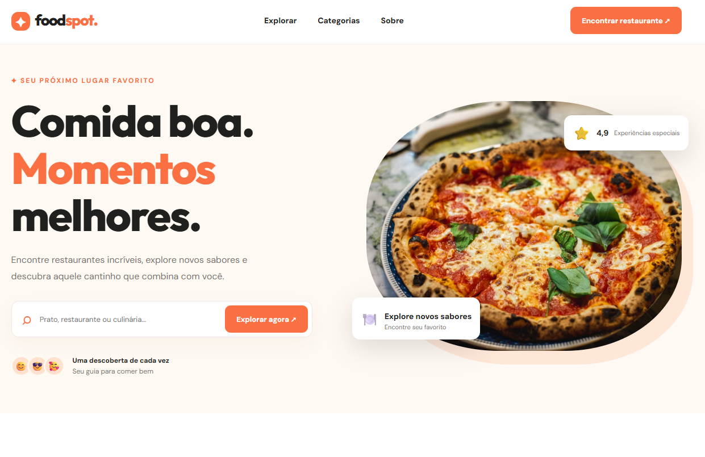
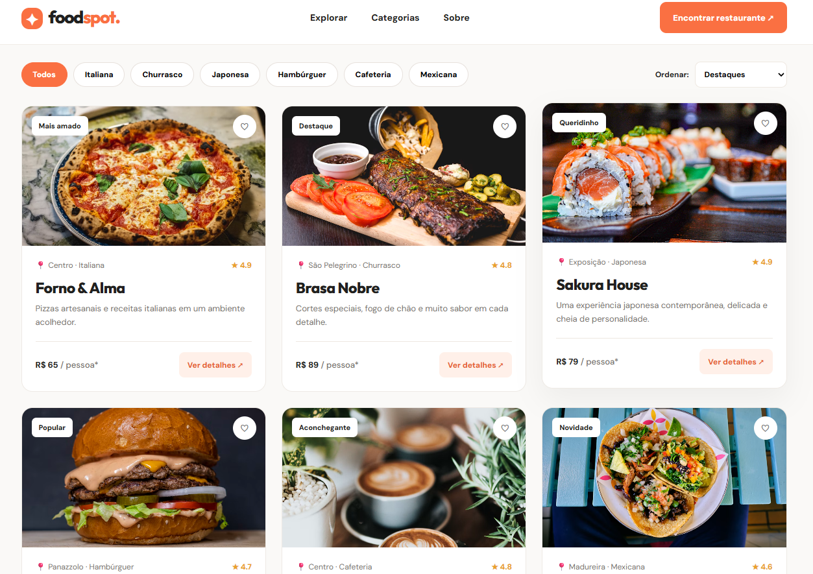
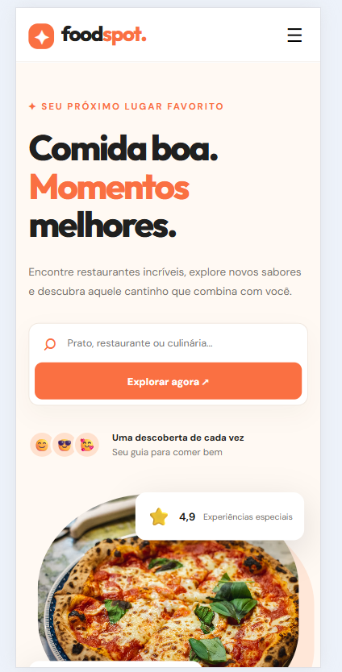
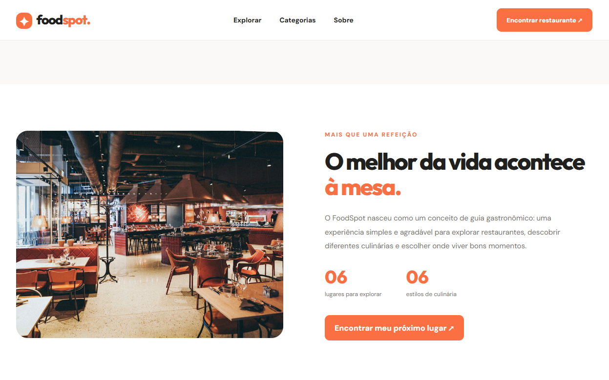
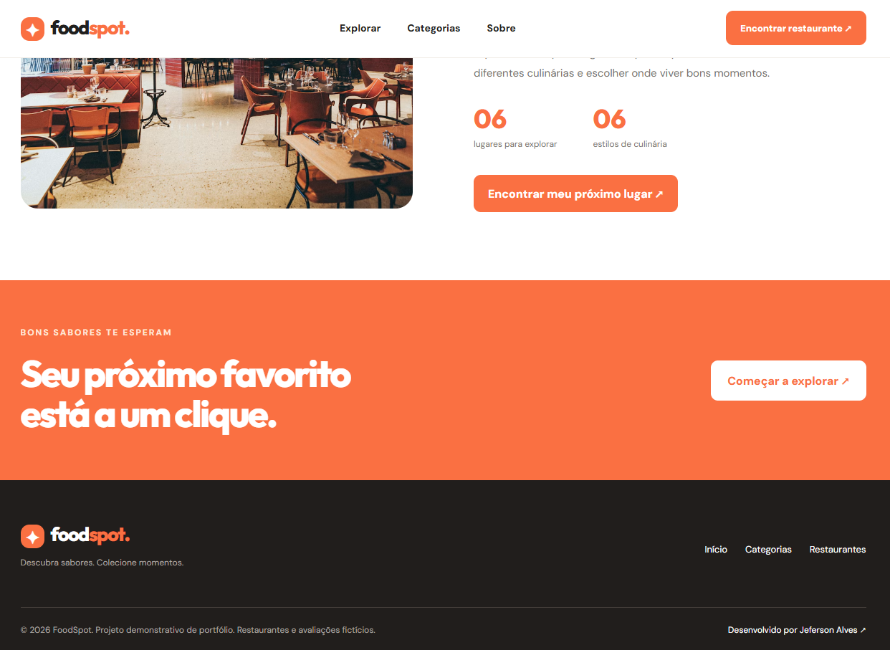

# FoodSpot 🍽️

**Guia gastronômico responsivo** para descobrir restaurantes fictícios, explorar culinárias e salvar favoritos. Projeto demonstrativo de frontend desenvolvido com HTML, CSS e JavaScript, sem backend.

## 🔗 Acessar o projeto

- **[Ver demonstração (GitHub Pages)](https://jefersonalvesrs.github.io/FoodSpot/)** — disponível após publicar o repositório e ativar o GitHub Pages.
- **[Repositório no GitHub](https://github.com/JefersonAlvesrs/FoodSpot)** — disponível após criar o repositório.

## ✨ Funcionalidades

- Catálogo de seis restaurantes fictícios com imagens e descrições
- Pesquisa por nome, culinária, bairro e descrição
- Filtros por categoria e ordenação por avaliação ou preço
- Favoritos persistidos no navegador com `localStorage`
- Janela de detalhes de cada restaurante
- Menu responsivo e navegação adaptada para dispositivos móveis

## 🛠️ Tecnologias

- **HTML5** — estrutura semântica
- **CSS3** — layout responsivo com Flexbox, Grid e media queries
- **JavaScript** — filtros, pesquisa, favoritos, modal e interações
- **Google Fonts** — tipografia (requer conexão para carregar as fontes externas)

As fotografias ilustrativas estão armazenadas localmente em `assets/images/`.

## 📸 Capturas de tela

### Página inicial


### Catálogo de restaurantes


### Versão mobile


### Sobre o projeto


### Rodapé


## 🚀 Executar localmente

1. Clone o repositório: `git clone https://github.com/JefersonAlvesrs/FoodSpot.git`
2. Abra a pasta `FoodSpot`.
3. Abra `index.html` no navegador ou use a extensão **Live Server** no VS Code.

Não é necessário instalar dependências ou configurar um servidor.

## 📁 Estrutura

```text
FoodSpot/
├── assets/
│   └── images/          # Fotografias locais dos restaurantes
├── screenshots/         # Capturas para o README e portfólio
├── index.html
├── styles.css
├── script.js
└── README.md
```

## ℹ️ Observações

Este é um **projeto fictício de portfólio**. Restaurantes, bairros, preços e avaliações são ilustrativos; não há reservas, pedidos ou pagamentos reais. As fotografias locais foram obtidas a partir das capturas de tela do protótipo, portanto sua nitidez é limitada pela resolução das capturas.

O layout desktop e mobile e as principais interações foram conferidos manualmente. A versão hospedada deverá ser verificada após a publicação.

## 👨‍💻 Autor

Desenvolvido por **Jeferson Alves** — [GitHub](https://github.com/JefersonAlvesrs).
